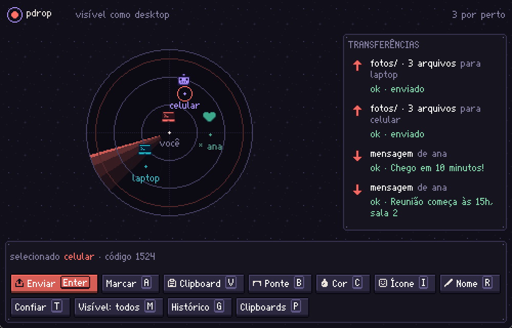
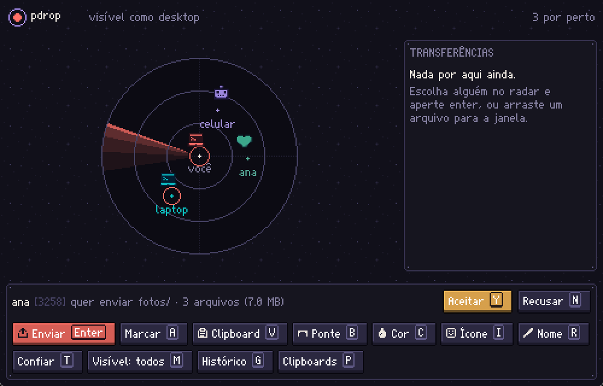
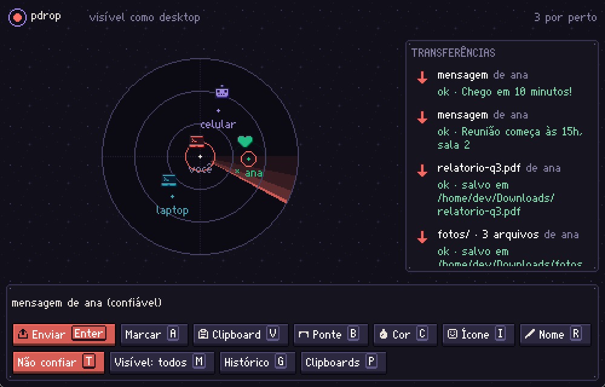
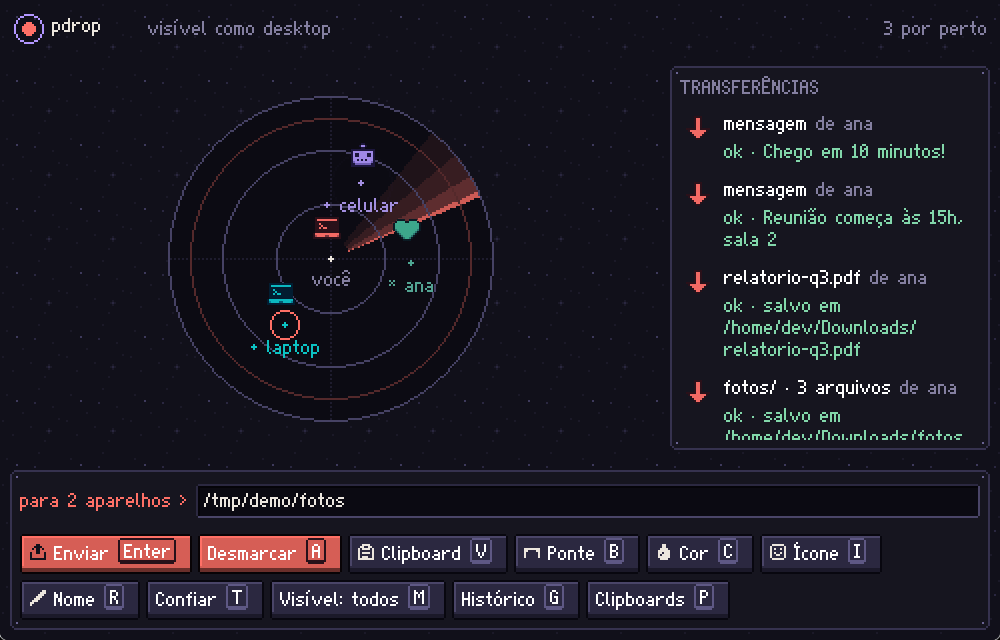
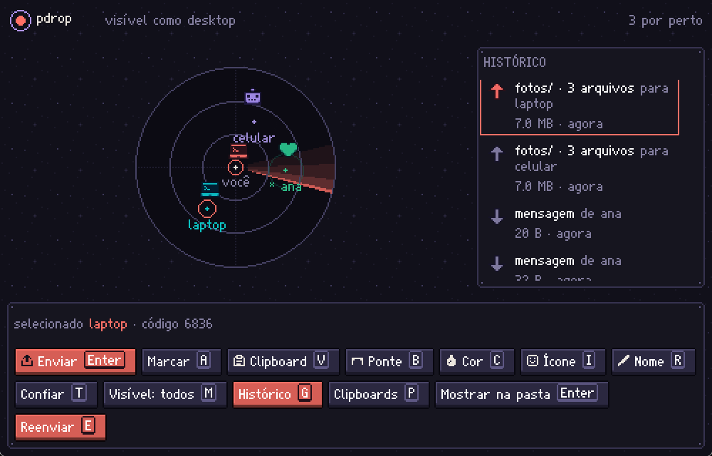
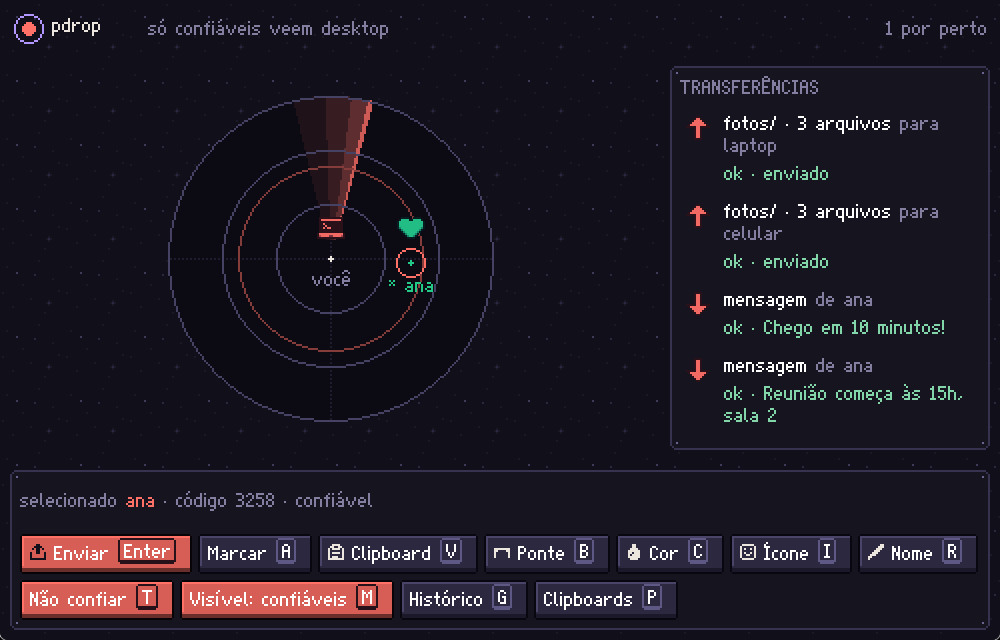
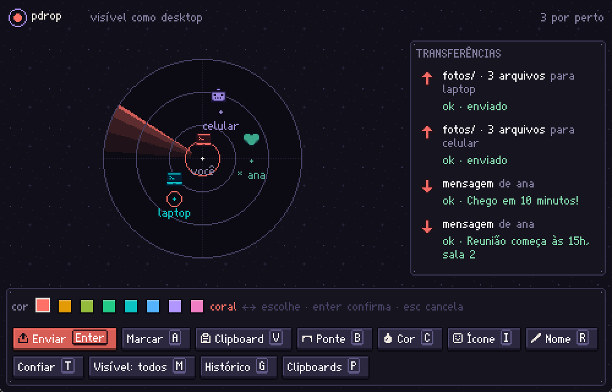

# ◉ pdrop

**English** · [Português](README.pt-BR.md)

**pdrop** is an [AirDrop](https://support.apple.com/explore/new/airdrop)-style sharing tool for your local network, wrapped in a live pixel-art **radar** window.

Run `pdrop` on two or more machines on the same network and they appear as blips on each other's radar. Select a peer and drop files, free-form text, or your clipboard to them — they get a prompt, accept, and it lands in their `~/Downloads` (or their clipboard). No accounts, no cloud: on the LAN everything travels directly, with no server. For devices on other networks you can optionally run your own [relay](#relay-pdrop-relay).

<p align="center"></p>

## A quick tour

**The radar is the interface.** Every device on your network is a blip: its color and icon are the ones its owner picked, closer blips have lower latency, and the sweep pings each one as it passes. Pick someone with `←/→`, press `enter`, and send. Every button shows its key.

**Accepting is explicit, and verifiable.** An incoming transfer asks before anything is written. The number in brackets (`[3258]`) is a pairing code that both sides compute from their cryptographic identities: if it matches what the sender sees on their screen, nobody is in the middle. A folder arrives as one transfer, with one accept.

<p align="center"></p>

**Trust the people you actually know.** Press `t` on a peer and their text messages arrive without a prompt (a trusted peer is marked `*`). Files and clipboard still ask. Here a trusted peer's message landed on its own, while the transfers panel shows everything received so far and where it was saved.

<p align="center"></p>

**Send to many at once.** `a` marks a peer (`shift+a` marks everyone); marked peers show a `+`, and the prompt switches to *para 2 aparelhos* (to 2 devices). Files, folders, text and the clipboard go to every marked peer, each with its own accept.

<p align="center"></p>

**Nothing gets lost.** `g` opens the history of everything sent and received (kept between runs). `↑/↓` browse, `enter` reveals the file in your file manager and `e` sends it again to whoever is selected, so a failed or forgotten transfer is one keypress away.

<p align="center"></p>

**Decide who can see you.** `m` cycles visibility: *everyone*, *trusted only* (you only see, and are only seen by, trusted devices) and *invisible* (you stop announcing yourself but can still send). In this shot only the trusted peer is left on the radar.

<p align="center"></p>

**Make it yours.** `c` picks your accent color, `i` your icon, `r` your name. They are broadcast, so other people see you the way you chose.

<p align="center"></p>

## What it can do

- **Send files** — type or paste a path (or drag files and folders onto the window; `~`, quotes, and `file://` URLs are cleaned up automatically).
- **Folders and many files** — type a folder path or drop several files/folders at once: one transfer, one accept. Empty folders and symlinks are skipped.
- **Resume + integrity** — every file is checked with a BLAKE3 hash on arrival. If the connection drops, send it again and it continues where it stopped (partials live in `~/Downloads/.pdrop-partial`, swept after 7 days). Corrupted files are rejected.
- **History** (`g`) — everything sent and received is kept (last 200) in `~/.config/pdrop/historico`. `↑/↓` browse, `enter` shows the file in your file manager, `e` sends it again to the selected peer.
- **Trusted devices** (`t`) — mark the selected peer as trusted and their *text messages* arrive without a prompt (files, clipboard and bridges still ask). Trust follows the device's cryptographic identity, not its display name. Trusted peers are marked with `*` on the radar.
- **Encryption + pairing** — every transfer runs inside a Noise XX channel (X25519, ChaChaPoly, BLAKE2s). Each device has a key pair in `~/.config/pdrop/chave` (owner-only); its uid is the hash of the public key, so it can't be impersonated. Select a peer and both screens show the same 4-digit code (`código 1234`) derived from the two identities: compare it out loud before pressing `t`. If someone is in the middle, the codes differ and a changed identity is refused outright.
- **Visibility** (`m`) — cycle *everyone* → *trusted only* (you only see and are only seen by trusted devices) → *invisible* (you emit nothing, but can still send to peers you see).
- **Send to several at once** (`a`) — mark peers with `a` (`shift+a` marks everyone, `esc` clears); marked peers show `+` on the radar. Files, text and one-shot clipboard then go to all of them, each with its own accept.
- **Clipboard history** (`p`) — the last 20 clipboards you *received* (memory only, gone on exit). `↑/↓` pick, `enter` puts it back on your clipboard.
- **Receive rules** — route what you receive by type, extension or sender in `~/.config/pdrop/destinos` (restart to apply); first matching rule wins, default is `~/Downloads` (or `--dir`):

  ```
  tipo:imagem = ~/Pictures       # imagem, video, audio, documento, compactado
  ext:pdf     = ~/Documents/pdf
  de:laptop   = ~/Downloads/laptop
  ```
  `tipo:`/`ext:` apply to loose files; `de:` applies to everything from that sender (folders included).
- **Scriptable CLI** — `pdrop send [--to NAME] [--as NAME] PATH|TEXT|-...` sends without opening the window (stdin with `-`, e.g. `tar c . | pdrop send --to laptop --as proj.tar -`). Exit code 0 delivered, 1 failed/refused, 2 bad usage or peer not found. Without `--to` it picks the only peer around, or lists them if there are several. Point a file manager's "open with"/script action at it for a right-click share.
- **Send text** — anything that isn't an existing file path is sent as a free-form message.
- **Clipboard share** (`v`) — push your whole clipboard to a peer once; it lands in their clipboard with the same type (text, or images with `wl-clipboard`/`xclip`).
- **Clipboard bridge** (`b`) — keep it on and *everything you copy* flows to the peer automatically, like a shared clipboard. The recipient approves once per session; repeat copies arrive without asking.
- **Live radar** — animated sweeping radar with blips for each peer, colored by their chosen accent, orbiting a pixel-art icon, pulsing when the sweep passes. Ping-based RTT places close peers on the inner ring.
- **Identity** — pick your display color (`c`), icon (`i`), and name (`r`); all persisted in `~/.config/pdrop` and broadcast so others see them.
- **Accept/refuse prompts** — incoming transfers ask y/n in-app, plus a desktop notification (`notify-send` on Linux, `osascript` on macOS) so you notice even when the window is in the background.
- **Safe by construction** — incoming file names are stripped to the last path component, existing files are never overwritten (`photo.jpg`, `photo (1).jpg`, …), failed writes delete the partial file, text messages are capped at 1 MiB and clipboard payloads at 64 MiB.

## Requirements

- A Rust toolchain (**Rust 2024 edition**, so Rust 1.85+) — only for building.
- Linux or macOS. (Anything with `cargo` should work; clipboard support is wired for Wayland/X11/macOS.)
- Optional clipboard helpers, auto-detected in this order:
  - macOS: `pbpaste`/`pbcopy` (built in, always present)
  - Wayland: `wl-clipboard` (`wl-copy`/`wl-paste`)
  - X11: `xclip`, then `xsel` as fallback

Without any clipboard tool, file and text transfers still work — the app just shows *"sem clipboard"* ("no clipboard") for clipboard features:

```bash
# Debian/Ubuntu
sudo apt install wl-clipboard    # Wayland
sudo apt install xclip           # X11
# Arch
sudo pacman -S wl-clipboard      # or: xclip
# Fedora
sudo dnf install wl-clipboard    # or: xclip
```

## Install

Pre-built packages are attached to each [release](https://github.com/Parsec-Inc/pdrop/releases):

| Platform | Install |
|---|---|
| Fedora / RHEL | `sudo dnf install ./pdrop-*.rpm` (COPR: `sudo dnf copr enable parsec-inc/pdrop`) |
| Debian / Ubuntu | `sudo apt install ./pdrop_*.deb` |
| Arch | `sudo pacman -U pdrop-*.pkg.tar.zst` (AUR: `yay -S pdrop`) |
| Snap | `sudo snap install pdrop` |
| macOS | `brew install Parsec-Inc/tap/pdrop` |
| Windows | run `pdrop-*.msi` |

Maintainers: see [docs/PACKAGING.md](docs/PACKAGING.md). Not every channel above is published yet.

### From source

```bash
git clone <this repo>
cd pdrop
cargo install --path .
```

`cargo install` puts the binary in `~/.cargo/bin` — make sure that's on your `PATH`.

### Static binary (musl)

The repo has already been built with the musl target, producing a fully static Linux binary with no runtime dependencies:

```bash
rustup target add x86_64-unknown-linux-musl
cargo build --release --target x86_64-unknown-linux-musl
# result: target/x86_64-unknown-linux-musl/release/pdrop
```

### Run without installing

```bash
cargo run --release -- --name laptop
```

## Usage

```bash
pdrop [--name NAME] [--peer IP]... [--dir FOLDER] [--calm] [--relay HOST:PORT] [--room SECRET]
pdrop send [--to NAME] [--peer IP]... [--as NAME] [--relay HOST:PORT] [--room SECRET] PATH|TEXT|-...
```

| Flag | Meaning |
|------|---------|
| `--name`, `-n NAME` | Display name for this session only (overrides the saved one). |
| `--peer`, `-p IP` | Also send discovery beacons directly to this IP. Repeat the flag for several peers. Useful on networks that filter broadcast/multicast — just point it at the other machine's IP. |
| `--dir`, `-d FOLDER` | Where received files go instead of `~/Downloads` (receive rules still apply first). |
| `--relay HOST:PORT`, `--room SECRET` | Reach devices on other networks (see [Connecting to a relay](#connecting-to-a-relay)). |
| `--calm` | Slower, quieter animation. Also slows down further while you're typing or a prompt is pending. |

With no valid arguments, it prints the usage line. Everything else is done inside the window, or with `pdrop send` (see above).

### Starting out

1. Run `pdrop` on both machines (same network, or the same [relay room](#connecting-to-a-relay)).
2. Each appears on the other's radar within a couple of seconds. Peers fade out after ~6 s of silence and disappear; new ones announce with an expanding ring.
3. Move the selection with `←/→` (or `h/l`, `Tab`).

### Keys

| Key | Action |
|-----|--------|
| `←/→`, `h/l`, `Tab`/`shift+Tab` | Select peer (or browse the open color/icon picker) |
| `enter`, `space` or `s` | Open the send prompt for the selected peer (confirms inside a picker) |
| *(drag & drop)* | Dropping a file on the window sends it to the selected peer |
| `v` | Send current clipboard once |
| `b` | Toggle the clipboard bridge to the selected peer |
| `x` | Cut all clipboard bridges others opened *toward* you |
| `c` | Pick your accent color (8-color palette, ←→ to browse, `enter` to confirm) |
| `i` | Pick your radar icon (11 pixel-art icons, or just the dot) |
| `r` | Rename yourself (max 32 chars, saved persistently) |
| `t` | Trust / untrust the selected peer (their text messages skip the prompt) |
| `m` | Cycle visibility: everyone / trusted only / invisible |
| `a` / `shift+a` | Mark the selected peer / mark everyone (send goes to all marked) |
| `p` | Open the received-clipboard history (`↑/↓`, `enter` to restore) |
| `g` | Open or close the history (`↑/↓` browse, `enter` show in folder, `e` resend) |
| `y` / `n` | Accept / refuse an incoming transfer or bridge request |
| `esc` | Cancel the open prompt or picker |
| `q`, `ctrl+c` | Quit |

The bottom bar shows context-sensitive hints for whatever is happening (prompt open, color picker, pending incoming transfer, …).

### Where things go

- **Received files** → `~/Downloads` (created if missing; never overwritten).
- **Received text/clipboard** → your clipboard (requires one of the clipboard tools above).
- **Your settings** (name, color, icon, device id, visibility, trusted devices, history) → `~/.config/pdrop/{nome,cor,icone,uid,visibilidade,confiaveis,historico}` as plain text.

## How it works

On the LAN everything is peer-to-peer, with no server. The optional [relay](#relay-pdrop-relay) only introduces devices on other networks and forwards their encrypted bytes.

- **Discovery** — a beacon `PDROP3|<id>|<port>|<color+icon>|<visibility>|<uid>|<name>` is broadcast over UDP port **47474** every 1.5 s. Because many Wi-Fi APs filter broadcast but pass unicast, pdrop also sweeps every host in its IPv4 subnets (up to /22) with 2 ms pacing, and `--peer` adds unicast targets. When a machine sees a *new* beacon it replies with its own beacon in unicast, so only one side needs to know the other's address. Peers also exchange `PING`/`PONG` to measure smoothed RTT.
- **Transfer** — a TCP connection to the peer's port **47475** (falls back to an ephemeral port, which the beacon advertises). Protocol is deliberately simple, one line then bytes:

  ```
  PDROP3\t<kind>\t<size>\t<sender>\t<label>\t<extra>\n   kind: f=files/folder, t=text, c=clipboard once, b=clipboard bridge
                                                                 extra: file count (f) or MIME type (c/b)
  recipient replies a single byte: Y or N
  t/c/b: ...payload bytes...
  f, once per file:
    <path>\t<size>\t<mtime>\n  ->  <offset>\n (resume point)  ->  bytes  ->  <blake3>\n  ->  K or E
  ```

  `PDROP3` is not compatible with older builds (they ignore it), so update every machine together.

  The color+icon ride in the same beacon field (`color | icon << 3`), so older builds that mask with `% 8` still show the right color.
- **Clipboard bridge** — the sender polls its clipboard every 400 ms and pushes any *new* text (its own last-written content is remembered to avoid echo loops). It stops by itself if the peer refuses, drops the connection, or leaves the network.
- **Notifications** — `notify-send`/`osascript`, with sender and file name passed as *arguments* (never interpolated into a command line) since they come from the network.

## Privacy & safety notes

- Transfers are encrypted and authenticated end to end, over the LAN or the relay; beacons are not (on the LAN, anyone on the network can see name, color, icon and uid unless you use the visibility modes).
- Anyone on the same network can see your pdrop beacon (name, color, icon) — that's how discovery works. Transfers are explicit and require the recipient's y/n, except text messages from peers you marked as trusted and bridge copies after a one-time grant (which you can cut with `x`).
- **With a relay there is no TLS.** Whoever can watch the network between you and the relay, and whoever runs it, can read your IP, the room id and your beacons (name, color, icon, visibility, device ids). What you send, including file names and exact transfer headers, stays inside the encrypted channel, though the relay sees who connects to whom, when and how much.
- **The room id is enough to join.** Someone who captures it does not need the secret: they can see the visible devices, send transfer requests (which still need your y/n), and disconnect a member by reusing its uid. They cannot pose as a trusted device or read your transfers. Names can be copied, so compare the pairing code before accepting from someone new. If the room may have leaked, switch every device to a new secret.
- Visibility modes are applied by the receiving app. On the relay, an *invisible* device sends no beacon but is still a room member, reachable by anyone who has the room id and its uid; with *trusted only*, beacons still reach the whole room.
- The clipboard bridge sends **everything you copy** while it's on. Password managers usually bypass the system clipboard, but double-check before bridging on a shared network.
- Incoming file names are sanitized (no paths, no control characters) and payloads are size-capped, but as with any LAN transfer tool, run it among people you trust.

## Troubleshooting

| Symptom | Try this |
|---------|----------|
| Peers never appear | Both sides must be on the same subnet. Firewalls often block UDP 47474/TCP 47475 — allow them, or use `--peer <other-ip>` on at least one side. Some guest/enterprise Wi-Fi isolates clients (AP isolation); no LAN tool can work across that. |
| Radar shows the peer but sends fail | On the LAN, TCP 47475 is likely blocked, or the peer already has something listening there. |
| *relay sem conexão* (relay offline) | The bar under the header says why. Check the address and port, that `pdrop-relay` is running, and that its port is open. pdrop keeps retrying. |
| Relay connected but no peers | Both devices need the very same secret, and the other one must not be *invisible*. |
| "sem clipboard" flash | Install `wl-clipboard` (Wayland) or `xclip` (X11); on macOS this shouldn't happen. |
| Clipboard bridge stops on its own | That's by design when the peer refuses, disconnects, or leaves — the header will say *ponte encerrada*. |
| Two instances on the same machine | Fine on Linux (SO_REUSEPORT); they'll see each other. |

## Relay (`pdrop-relay`)

`pdrop-relay` is a small server for connecting devices that are not on the same network. It has no accounts and no global device list: a **room** is the `blake3` of a secret that only its members know (64 hex), and devices only see others in the same room. Use a random secret (128 bits or more); a short human-chosen phrase can be guessed. Content stays end-to-end encrypted (Noise): the relay forwards bytes and sees only who talks to whom and how much. See [Connecting to a relay](#connecting-to-a-relay) for the client side.

```bash
cargo build --release --bin pdrop-relay
pdrop-relay --listen 0.0.0.0:443     # default
```

### Connecting to a relay

Every device needs the relay address and the same room secret. Generate the secret once with `openssl rand -hex 16`; it needs at least 16 characters, but length alone does not make it strong.

The preferred way is to write the two files (the secret stays out of your shell history and process list):

```bash
mkdir -p ~/.config/pdrop
echo relay.example.com:443 > ~/.config/pdrop/relay
(umask 077; cat > ~/.config/pdrop/sala)   # paste the secret, press enter, then ctrl+d
```

`--relay HOST:PORT` and `--room SECRET` work too: the window saves them to those files, while `pdrop send` uses them for that run only. `PDROP_RELAY` and `PDROP_ROOM` are also accepted and never saved. Each value is taken from the flag, then the variable, then the file. To turn the relay off, delete both files.

An invalid flag stops pdrop; an invalid saved or environment value only disables the relay, with a warning. A device reachable both ways is used over the LAN.

**Protocol** — one line per message, ending in `\n`:

| Message | Meaning |
|---------|---------|
| `HELLO <room> <uid>` | Control connection. The relay answers `OK` (or closes). |
| `BEACON <text>` | Client → relay, every few seconds; forwarded to the room. The app uses 1.5 s and `<id>\|<color+icon>\|<visibility>\|<name>`. |
| any other line, e.g. `PING` | Client → relay: ignored, but keeps the connection alive (used when invisible). Silence for more than 30 s drops the member. |
| `BEACON <uid> <text>`, `GONE <uid>`, `INCOMING <token>` | Relay → client: presence of another member, a member left, someone wants to connect. |
| `DIAL <room> <target_uid>` | New connection asking for a tunnel to a member. `OK` (raw bytes follow) or `ERR`. |
| `ACCEPT <room> <uid> <token>` | The target's answer to `INCOMING`, on a new connection. `OK`, then the same tunnel. |

**Limits** — 32 connections per IP, 32 members per room, 1024 rooms, per minute and per IP, 30 control requests (`HELLO`) and 120 tunnel requests (`DIAL`, `ACCEPT`), 10 s for the target to accept, 120 s without traffic closes a tunnel. Room ids are never logged.

**Known shortcuts**
- A repeated uid in a room replaces the old one (so reconnecting works). A member could kick another with a forged uid, but cannot hijack a transfer: the Noise handshake checks the uid.
- Behind a shared NAT, users split the per-IP rate limit.
- No TLS between client and relay: content is already encrypted, but the room id and beacons travel in clear (see [Privacy](#privacy--safety-notes)).
- Two windows with the same identity (same user on one machine) replace each other in the room. `pdrop send` avoids this by joining with a throwaway uid.
- Tunnel tokens come from `/dev/urandom`, so the relay is Unix-only.

**Hosting on a VM** — 1 vCPU and 512 MB–1 GB of RAM are enough; bandwidth is what matters (every transferred byte enters and leaves the VM), so pick the provider by its outbound traffic allowance. Open a single TCP port (443 passes most restrictive networks) plus SSH, and run it under systemd with [`packaging/relay/pdrop-relay.service`](packaging/relay/pdrop-relay.service) (unprivileged, `CAP_NET_BIND_SERVICE` only). Setting `net.ipv4.tcp_keepalive_time=60` helps drop dead sessions.

## Project layout

```
src/
├── main.rs    App state, key handling, settings, history, notifications, `pdrop send` CLI
├── net.rs     Discovery (UDP sweep/broadcast), file/folder protocol with resume + hashing, receive rules
├── secure.rs  Noise XX encrypted channel, device identity, pairing code
├── ui.rs      The egui radar: pixel-art sprites, blips, panels, footer
├── relay.rs   Relay client: presence in a room and tunnels
├── clip.rs    Clipboard via system tools (wl-clipboard / xclip / xsel / pbcopy)
└── bin/pdrop-relay.rs  Relay server: rooms + TCP tunnel
assets/        Aseprite sources and exported PNGs (font, icons, sprites)
```

Main dependencies: `eframe`/`egui` (window and rendering), `snow` (Noise encryption), `blake3` (file integrity), `socket2` (broadcast/reuse sockets) and `if-addrs` (subnet scan).

## Building & testing

```bash
cargo build --release
cargo test        # loopback transfers (file, folder, text, resume, integrity), encrypted channel, routing, visibility, relay
```

## Status & license

v0.1.2 — early, single-purpose, and it works. Known gaps: discovery beacons are not encrypted or authenticated (transfers are), discovery is IPv4-only, and empty folders and symlinks are not sent.

Released under the [MIT license](LICENSE).
