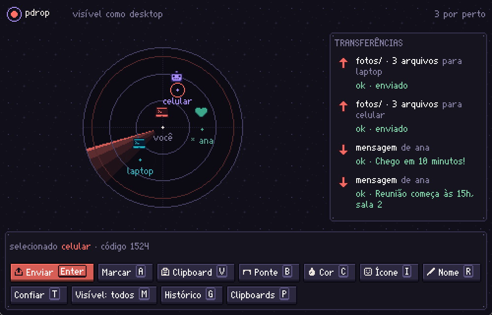
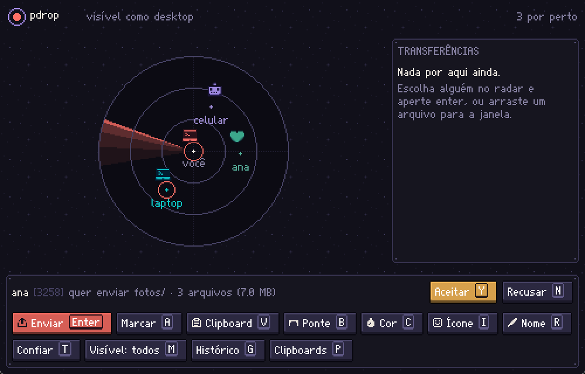
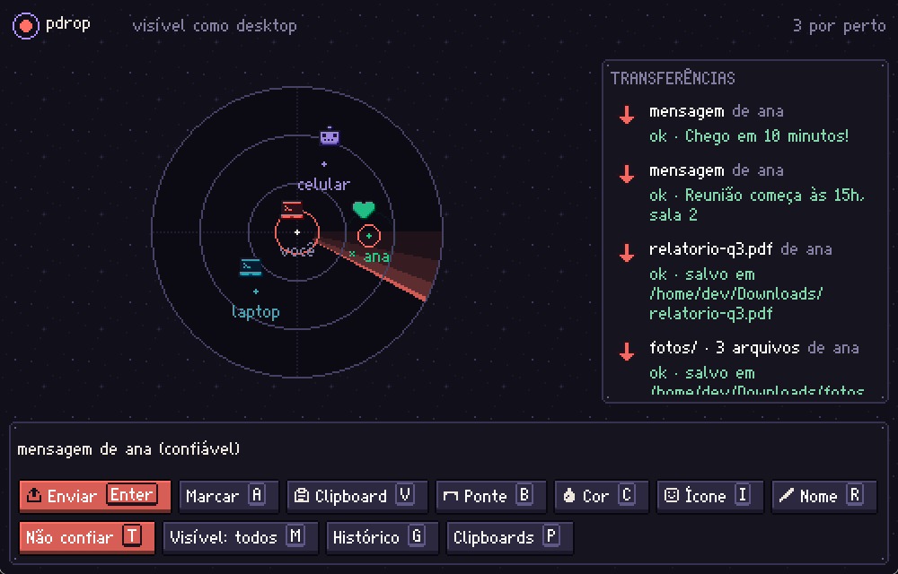
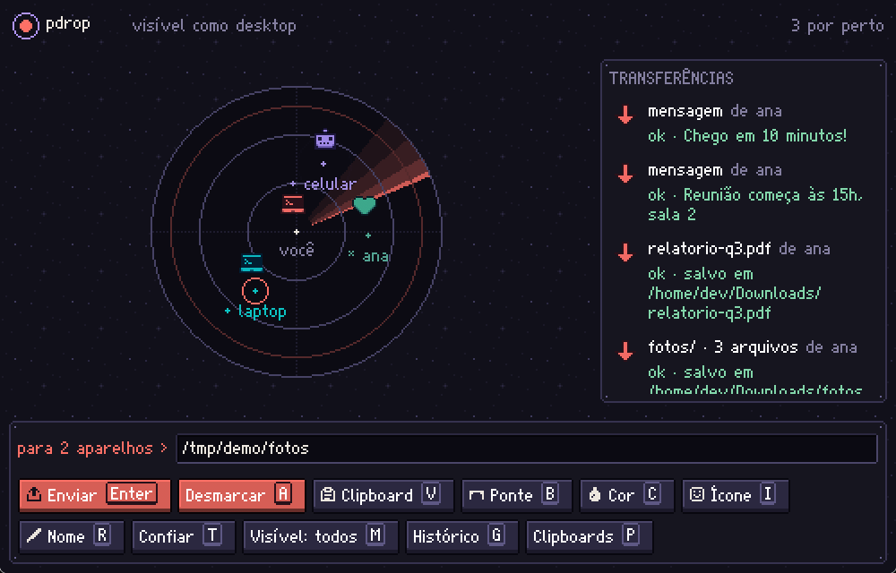
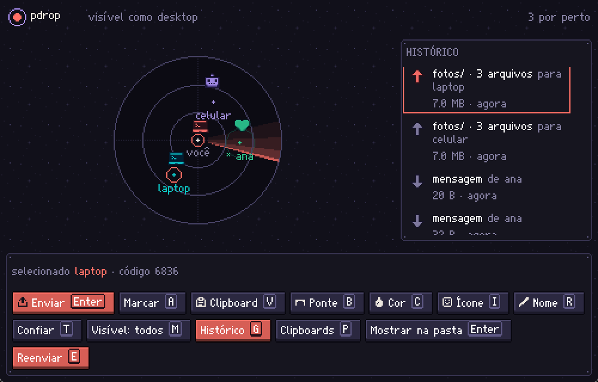
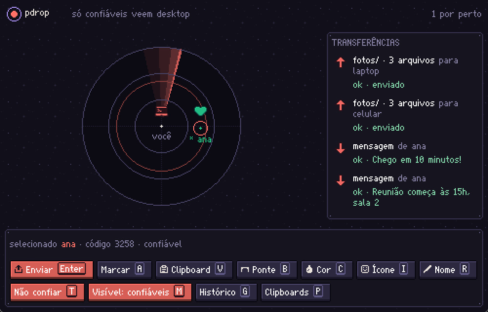
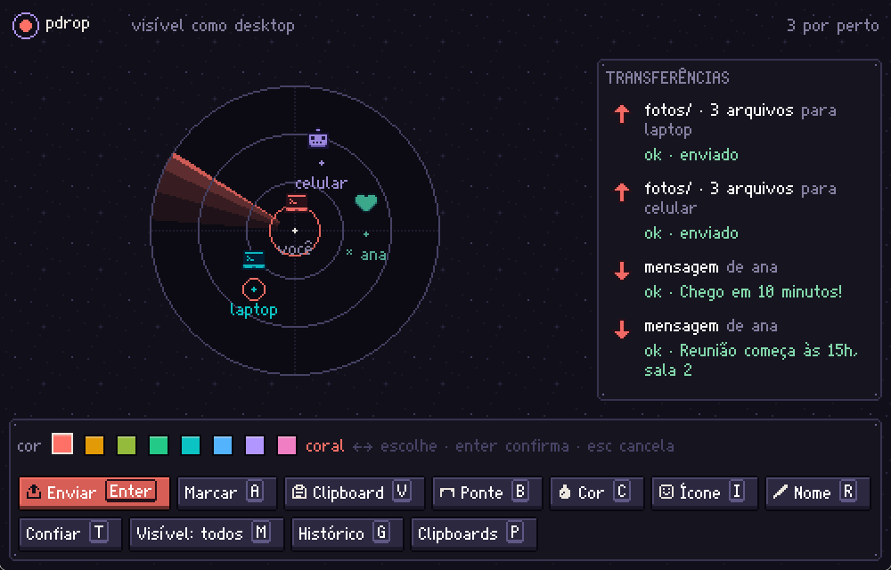

# ◉ pdrop

[English](README.md) · **Português**

O **pdrop** é uma ferramenta de compartilhamento na rede local no estilo do [AirDrop](https://support.apple.com/explore/new/airdrop), com uma janela de **radar** em pixel art ao vivo.

Abra o `pdrop` em duas ou mais máquinas na mesma rede e elas aparecem como pontos no radar uma da outra. Escolha alguém e envie arquivos, texto livre ou o seu clipboard: a pessoa recebe um pedido, aceita, e o conteúdo cai no `~/Downloads` dela (ou no clipboard). Sem contas, sem servidores, sem nuvem: tudo viaja direto pela rede local.

<p align="center"></p>

## Um tour rápido

**O radar é a interface.** Cada aparelho da rede é um ponto: a cor e o ícone são os que a pessoa escolheu, pontos mais próximos têm latência menor e a varredura "pinga" cada um quando passa. Escolha alguém com `←/→`, aperte `enter` e envie. Todo botão mostra o seu atalho.

**Aceitar é explícito e verificável.** Uma transferência recebida pergunta antes de gravar qualquer coisa. O número entre colchetes (`[3258]`) é um código de pareamento que os dois lados calculam a partir das identidades criptográficas: se ele bate com o que o remetente vê na tela dele, ninguém está no meio. Uma pasta chega como uma transferência só, com um aceite só.

<p align="center"></p>

**Confie em quem você conhece.** Aperte `t` num peer e as mensagens de texto dele chegam sem pedir aceite (peer confiável aparece com `*`). Arquivos e clipboard continuam perguntando. Aqui a mensagem de um confiável chegou sozinha, e o painel de transferências mostra tudo o que foi recebido até agora e onde foi salvo.

<p align="center"></p>

**Envie para vários de uma vez.** O `a` marca um peer (`shift+a` marca todos); os marcados ganham um `+` e o prompt passa a dizer *para 2 aparelhos*. Arquivos, pastas, texto e clipboard vão para todos os marcados, cada um com o seu aceite.

<p align="center"></p>

**Nada se perde.** O `g` abre o histórico de tudo o que foi enviado e recebido (guardado entre execuções). `↑/↓` navegam, `enter` mostra o arquivo no gerenciador de arquivos e `e` envia de novo para quem estiver selecionado, então uma transferência que falhou ou foi esquecida fica a uma tecla de distância.

<p align="center"></p>

**Decida quem pode te ver.** O `m` alterna a visibilidade: *todos*, *só confiáveis* (você só vê, e só é visto por, aparelhos confiáveis) e *invisível* (você para de se anunciar, mas ainda pode enviar). Nesta imagem só o peer confiável sobrou no radar.

<p align="center"></p>

**Deixe com a sua cara.** O `c` escolhe a sua cor, o `i` o seu ícone e o `r` o seu nome. Eles são divulgados na rede, então os outros te veem do jeito que você escolheu.

<p align="center"></p>

## O que ele faz

- **Enviar arquivos** — digite ou cole um caminho (ou arraste arquivos e pastas para a janela; `~`, aspas e URLs `file://` são tratados automaticamente).
- **Pastas e vários arquivos** — digite o caminho de uma pasta ou solte vários arquivos/pastas de uma vez: uma transferência, um aceite. Pastas vazias e links simbólicos são ignorados.
- **Retomada e integridade** — cada arquivo é conferido com um hash BLAKE3 ao chegar. Se a conexão cair, envie de novo e ele continua de onde parou (os pedaços ficam em `~/Downloads/.pdrop-partial`, apagados após 7 dias). Arquivos corrompidos são rejeitados.
- **Histórico** (`g`) — tudo o que foi enviado e recebido fica guardado (os últimos 200) em `~/.config/pdrop/historico`. `↑/↓` navegam, `enter` mostra o arquivo no gerenciador de arquivos, `e` envia de novo para o peer selecionado.
- **Aparelhos confiáveis** (`t`) — marque o peer selecionado como confiável e as *mensagens de texto* dele chegam sem pedir aceite (arquivos, clipboard e pontes continuam perguntando). A confiança segue a identidade criptográfica do aparelho, não o nome exibido. Peers confiáveis aparecem com `*` no radar.
- **Criptografia e pareamento** — toda transferência roda dentro de um canal Noise XX (X25519, ChaChaPoly, BLAKE2s). Cada aparelho tem um par de chaves em `~/.config/pdrop/chave` (só o dono lê); o uid é o hash da chave pública, então não dá para se passar por outro aparelho. Ao selecionar um peer, as duas telas mostram o mesmo código de 4 dígitos (`código 1234`), derivado das duas identidades: confira de voz antes de apertar `t`. Se alguém estiver no meio, os códigos diferem e uma identidade que mudou é recusada na hora.
- **Visibilidade** (`m`) — alterna *todos* → *só confiáveis* (você só vê e só é visto por aparelhos confiáveis) → *invisível* (você não emite nada, mas ainda pode enviar para os peers que vê).
- **Enviar para vários** (`a`) — marque peers com `a` (`shift+a` marca todos, `esc` limpa); os marcados mostram `+` no radar. Arquivos, texto e clipboard avulso vão então para todos, cada um com o seu aceite.
- **Histórico de clipboard** (`p`) — os últimos 20 clipboards que você *recebeu* (só em memória, somem ao fechar). `↑/↓` escolhem, `enter` devolve o item ao seu clipboard.
- **Regras de recebimento** — direcione o que você recebe por tipo, extensão ou remetente em `~/.config/pdrop/destinos` (reinicie para aplicar); a primeira regra que casar vence e o padrão é `~/Downloads` (ou `--dir`):

  ```
  tipo:imagem = ~/Pictures       # imagem, video, audio, documento, compactado
  ext:pdf     = ~/Documents/pdf
  de:laptop   = ~/Downloads/laptop
  ```
  `tipo:` e `ext:` valem para arquivos soltos; `de:` vale para tudo vindo daquele remetente (pastas inclusas).
- **CLI para scripts** — `pdrop send [--to NOME] [--as NOME] CAMINHO|TEXTO|-...` envia sem abrir a janela (stdin com `-`, por exemplo `tar c . | pdrop send --to laptop --as proj.tar -`). Código de saída 0 se entregou, 1 se falhou ou foi recusado, 2 se o uso estiver errado ou o peer não for encontrado. Sem `--to`, ele usa o único peer por perto ou lista os candidatos se houver vários. Aponte uma ação de "abrir com"/script do gerenciador de arquivos para ele e você ganha o compartilhamento pelo botão direito.
- **Enviar texto** — qualquer coisa que não seja um caminho de arquivo existente vai como mensagem livre.
- **Compartilhar clipboard** (`v`) — envia o clipboard inteiro uma vez; ele cai no clipboard do peer com o mesmo tipo (texto, ou imagens com `wl-clipboard`/`xclip`).
- **Ponte de clipboard** (`b`) — ligada, *tudo o que você copia* vai para o peer automaticamente, como um clipboard compartilhado. Quem recebe aprova uma vez por sessão; as cópias seguintes chegam sem perguntar.
- **Radar ao vivo** — radar animado com a varredura e um ponto para cada peer, na cor de destaque escolhida por ele, com um ícone em pixel art orbitando e pulsando quando a varredura passa. A latência (RTT) coloca os peers próximos no anel interno.
- **Identidade** — escolha a sua cor (`c`), o ícone (`i`) e o nome (`r`); tudo fica salvo em `~/.config/pdrop` e é divulgado para os outros verem.
- **Pedidos de aceitar/recusar** — as transferências recebidas perguntam y/n no app, além de uma notificação do sistema (`notify-send` no Linux, `osascript` no macOS) para você perceber mesmo com a janela em segundo plano.
- **Seguro por construção** — os nomes de arquivo recebidos são reduzidos ao último componente do caminho, arquivos existentes nunca são sobrescritos (`foto.jpg`, `foto (1).jpg`, …), uma gravação que falha apaga o arquivo parcial, mensagens de texto são limitadas a 1 MiB e o clipboard a 64 MiB.

## Requisitos

- Uma toolchain Rust (**edição 2024 do Rust**, ou seja, Rust 1.85+) — só para compilar.
- Linux ou macOS. (Qualquer coisa com `cargo` deve funcionar; o suporte a clipboard cobre Wayland, X11 e macOS.)
- Ferramentas opcionais de clipboard, detectadas nesta ordem:
  - macOS: `pbpaste`/`pbcopy` (nativas, sempre presentes)
  - Wayland: `wl-clipboard` (`wl-copy`/`wl-paste`)
  - X11: `xclip`, depois `xsel` como alternativa

Sem nenhuma ferramenta de clipboard, transferências de arquivo e texto continuam funcionando — o app só mostra *"sem clipboard"* nas funções de clipboard:

```bash
# Debian/Ubuntu
sudo apt install wl-clipboard    # Wayland
sudo apt install xclip           # X11
# Arch
sudo pacman -S wl-clipboard      # ou: xclip
# Fedora
sudo dnf install wl-clipboard    # ou: xclip
```

## Instalação

Os pacotes prontos ficam anexados a cada [release](https://github.com/Parsec-Inc/pdrop/releases):

| Plataforma | Instalação |
|---|---|
| Fedora / RHEL | `sudo dnf install ./pdrop-*.rpm` (COPR: `sudo dnf copr enable parsec-inc/pdrop`) |
| Debian / Ubuntu | `sudo apt install ./pdrop_*.deb` |
| Arch | `sudo pacman -U pdrop-*.pkg.tar.zst` (AUR: `yay -S pdrop`) |
| Snap | `sudo snap install pdrop` |
| macOS | `brew install Parsec-Inc/tap/pdrop` |
| Windows | execute o `pdrop-*.msi` |

Para quem mantém os pacotes: veja [docs/PACKAGING.md](docs/PACKAGING.md). Nem todos os canais acima estão publicados ainda.

### A partir do código-fonte

```bash
git clone <este repositório>
cd pdrop
cargo install --path .
```

O `cargo install` coloca o binário em `~/.cargo/bin` — confira se essa pasta está no seu `PATH`.

### Binário estático (musl)

O repositório já foi compilado com o alvo musl, gerando um binário Linux totalmente estático e sem dependências em tempo de execução:

```bash
rustup target add x86_64-unknown-linux-musl
cargo build --release --target x86_64-unknown-linux-musl
# resultado: target/x86_64-unknown-linux-musl/release/pdrop
```

### Rodar sem instalar

```bash
cargo run --release -- --name laptop
```

## Uso

```bash
pdrop [--name NOME] [--peer IP]... [--dir PASTA] [--calm]
pdrop send [--to NOME] [--peer IP]... [--as NOME] CAMINHO|TEXTO|-...
```

| Opção | Significado |
|------|---------|
| `--name`, `-n NOME` | Nome exibido só nesta sessão (sobrepõe o salvo). |
| `--peer`, `-p IP` | Também envia os beacons de descoberta direto para esse IP. Repita a opção para vários peers. Útil em redes que filtram broadcast/multicast — basta apontar para o IP da outra máquina. |
| `--dir`, `-d PASTA` | Onde os arquivos recebidos caem, no lugar de `~/Downloads` (as regras de recebimento continuam valendo primeiro). |
| `--calm` | Animação mais lenta e discreta. Fica ainda mais lenta enquanto você digita ou há um pedido pendente. |

Sem argumentos válidos, ele imprime a linha de uso. Todo o resto é feito dentro da janela, ou com `pdrop send` (veja acima).

### Começando

1. Abra o `pdrop` nas duas máquinas (mesma rede).
2. Cada uma aparece no radar da outra em poucos segundos. Os peers somem depois de ~6 s de silêncio; os novos chegam com um anel que se expande.
3. Mova a seleção com `←/→` (ou `h/l`, `Tab`).

### Teclas

| Tecla | Ação |
|-----|--------|
| `←/→`, `h/l`, `Tab`/`shift+Tab` | Seleciona o peer (ou navega no seletor de cor/ícone aberto) |
| `enter`, `espaço` ou `s` | Abre o prompt de envio para o peer selecionado (confirma dentro de um seletor) |
| *(arrastar e soltar)* | Soltar um arquivo na janela envia para o peer selecionado |
| `v` | Envia o clipboard atual uma vez |
| `b` | Liga/desliga a ponte de clipboard para o peer selecionado |
| `x` | Corta todas as pontes de clipboard que outros abriram *para* você |
| `c` | Escolhe a sua cor de destaque (paleta de 8 cores, ←→ navega, `enter` confirma) |
| `i` | Escolhe o seu ícone no radar (11 ícones em pixel art, ou só o ponto) |
| `r` | Renomeia você mesmo (máx. 32 caracteres, salvo de forma persistente) |
| `t` | Confia / deixa de confiar no peer selecionado (as mensagens de texto dele não pedem aceite) |
| `m` | Alterna a visibilidade: todos / só confiáveis / invisível |
| `a` / `shift+a` | Marca o peer selecionado / marca todos (o envio vai para todos os marcados) |
| `p` | Abre o histórico de clipboards recebidos (`↑/↓`, `enter` para restaurar) |
| `g` | Abre ou fecha o histórico (`↑/↓` navegam, `enter` mostra na pasta, `e` reenvia) |
| `y` / `n` | Aceita / recusa uma transferência ou pedido de ponte recebido |
| `esc` | Cancela o prompt ou seletor aberto |
| `q`, `ctrl+c` | Sai |

A barra de baixo mostra dicas conforme o contexto, para o que estiver acontecendo (prompt aberto, seletor de cor, transferência pendente, …).

### Onde as coisas vão parar

- **Arquivos recebidos** → `~/Downloads` (criada se não existir; nada é sobrescrito).
- **Texto/clipboard recebido** → o seu clipboard (exige uma das ferramentas de clipboard acima).
- **Suas configurações** (nome, cor, ícone, id do aparelho, visibilidade, confiáveis, histórico) → `~/.config/pdrop/{nome,cor,icone,uid,visibilidade,confiaveis,historico}` em texto puro.

## Como funciona

Tudo é ponto a ponto na rede local; não existe servidor em lugar nenhum.

- **Descoberta** — um beacon `PDROP3|<id>|<porta>|<cor+ícone>|<visibilidade>|<uid>|<nome>` é enviado por broadcast UDP na porta **47474** a cada 1,5 s. Como muitos APs de Wi-Fi filtram broadcast mas deixam passar unicast, o pdrop também varre todos os hosts das suas sub-redes IPv4 (até /22) com intervalo de 2 ms, e o `--peer` adiciona alvos em unicast. Quando uma máquina vê um beacon *novo*, ela responde com o próprio beacon em unicast, então basta um lado conhecer o endereço do outro. Os peers também trocam `PING`/`PONG` para medir o RTT suavizado.
- **Transferência** — uma conexão TCP na porta **47475** do peer (cai para uma porta efêmera, que o beacon divulga). O protocolo é de propósito simples, uma linha e depois os bytes:

  ```
  PDROP3\t<tipo>\t<tamanho>\t<remetente>\t<rótulo>\t<extra>\n   tipo: f=arquivos/pasta, t=texto, c=clipboard uma vez, b=ponte de clipboard
                                                                  extra: nº de arquivos (f) ou tipo MIME (c/b)
  o destinatário responde um único byte: Y ou N
  t/c/b: ...bytes do conteúdo...
  f, uma vez por arquivo:
    <caminho>\t<tamanho>\t<mtime>\n  ->  <offset>\n (ponto de retomada)  ->  bytes  ->  <blake3>\n  ->  K ou E
  ```

  O `PDROP3` não é compatível com versões antigas (elas o ignoram), então atualize todas as máquinas juntas.

  A cor e o ícone viajam no mesmo campo do beacon (`cor | ícone << 3`), então versões antigas que aplicam `% 8` ainda mostram a cor certa.
- **Ponte de clipboard** — o remetente consulta o clipboard a cada 400 ms e envia qualquer texto *novo* (o último conteúdo que ele mesmo gravou é lembrado para evitar laços de eco). Ela para sozinha se o peer recusar, derrubar a conexão ou sair da rede.
- **Notificações** — `notify-send`/`osascript`, com o remetente e o nome do arquivo passados como *argumentos* (nunca montados dentro de uma linha de comando), já que vêm da rede.

## Notas de privacidade e segurança

- As transferências são criptografadas e autenticadas ponta a ponta; os beacons não são (qualquer um na rede vê nome, cor, ícone e uid, a menos que você use os modos de visibilidade).
- Qualquer pessoa na mesma rede pode ver o seu beacon do pdrop (nome, cor, ícone) — é assim que a descoberta funciona. As transferências são explícitas e exigem o y/n de quem recebe, exceto mensagens de texto de peers que você marcou como confiáveis e cópias da ponte depois de uma liberação única (que você corta com `x`).
- A ponte de clipboard envia **tudo o que você copia** enquanto está ligada. Gerenciadores de senha costumam contornar o clipboard do sistema, mas confira antes de ligar a ponte numa rede compartilhada.
- Os nomes de arquivo recebidos são saneados (sem caminhos, sem caracteres de controle) e o tamanho do conteúdo é limitado, mas, como em qualquer ferramenta de transferência na rede local, use entre pessoas em quem você confia.

## Solução de problemas

| Sintoma | O que tentar |
|---------|----------|
| Os peers nunca aparecem | Os dois lados precisam estar na mesma sub-rede. Firewalls costumam bloquear UDP 47474/TCP 47475 — libere essas portas, ou use `--peer <ip-do-outro>` em pelo menos um lado. Algumas redes Wi-Fi de visitantes/corporativas isolam os clientes (AP isolation); nenhuma ferramenta de rede local funciona assim. |
| O radar mostra o peer, mas o envio falha | Provavelmente o TCP 47475 está bloqueado, ou o peer já tem outra coisa escutando nessa porta. |
| Aviso "sem clipboard" | Instale `wl-clipboard` (Wayland) ou `xclip` (X11); no macOS isso não deveria acontecer. |
| A ponte de clipboard para sozinha | É de propósito quando o peer recusa, desconecta ou sai — o cabeçalho avisa *ponte encerrada*. |
| Duas instâncias na mesma máquina | Funciona no Linux (SO_REUSEPORT); elas se enxergam. |

## Relay (`pdrop-relay`)

O `pdrop-relay` é um servidor pequeno para conectar aparelhos que não estão na mesma rede. Não tem contas nem lista global de aparelhos: uma **sala** é o `blake3` de um segredo que só os membros conhecem (64 hex), e cada aparelho só enxerga quem está na mesma sala. Use um segredo aleatório (128 bits ou mais); uma frase curta escolhida por uma pessoa pode ser adivinhada. O conteúdo continua cifrado ponta a ponta (Noise): o relay repassa bytes e só vê quem fala com quem e o volume. O lado do cliente (`--relay`, `--room`) ainda não está ligado ao app.

```bash
cargo build --release --bin pdrop-relay
pdrop-relay --listen 0.0.0.0:443     # padrão
```

**Protocolo** — uma linha por mensagem, terminada em `\n`:

| Mensagem | Significado |
|----------|-------------|
| `HELLO <sala> <uid>` | Conexão de controle. O relay responde `OK` (ou fecha). |
| `BEACON <texto>` | Cliente → relay, a cada poucos segundos. Mais de 30 s de silêncio derruba o membro. |
| `BEACON <uid> <texto>`, `GONE <uid>`, `INCOMING <token>` | Relay → cliente: presença de outro membro, um membro saiu, alguém quer conectar. |
| `DIAL <sala> <uid_alvo>` | Nova conexão pedindo um túnel até um membro. `OK` (daí em diante, bytes crus) ou `ERR`. |
| `ACCEPT <sala> <uid> <token>` | Resposta do alvo ao `INCOMING`, em uma nova conexão. `OK`, e o mesmo túnel. |

**Limites** — 32 conexões por IP, 32 membros por sala, 1024 salas, 30 requisições por minuto por IP, 10 s para o alvo aceitar, 120 s sem tráfego encerra o túnel. Ids de sala nunca são registrados em log.

**Atalhos conhecidos**
- Um uid repetido na sala substitui o antigo (para a reconexão funcionar). Um membro pode derrubar outro com um uid forjado, mas não consegue sequestrar uma transferência: o handshake Noise confere o uid.
- Atrás de um NAT compartilhado, os usuários dividem o limite de requisições por IP.
- Sem TLS entre cliente e relay: o conteúdo já é cifrado, mas o id da sala trafega em claro.
- Os tokens de túnel vêm de `/dev/urandom`, então o relay só roda em Unix.

**Hospedando numa VM** — 1 vCPU e 512 MB a 1 GB de RAM bastam; o que pesa é a banda (cada byte transferido entra e sai da VM), então escolha o provedor pela franquia de tráfego de saída. Abra uma única porta TCP (a 443 passa pela maioria das redes restritivas) mais o SSH, e rode sob systemd com [`packaging/relay/pdrop-relay.service`](packaging/relay/pdrop-relay.service) (sem root, só `CAP_NET_BIND_SERVICE`). Configurar `net.ipv4.tcp_keepalive_time=60` ajuda a derrubar sessões mortas.

## Estrutura do projeto

```
src/
├── main.rs    Estado do app, teclas, configurações, histórico, notificações, CLI `pdrop send`
├── net.rs     Descoberta (varredura/broadcast UDP), protocolo de arquivos/pastas com retomada e hash, regras de recebimento
├── secure.rs  Canal criptografado Noise XX, identidade do aparelho, código de pareamento
├── ui.rs      O radar em egui: sprites em pixel art, pontos, painéis, rodapé
├── clip.rs    Clipboard via ferramentas do sistema (wl-clipboard / xclip / xsel / pbcopy)
└── bin/pdrop-relay.rs  Servidor relay: salas + túnel TCP
assets/        Fontes em Aseprite e PNGs exportados (fonte, ícones, sprites)
```

Principais dependências: `eframe`/`egui` (janela e renderização), `snow` (criptografia Noise), `blake3` (integridade dos arquivos), `socket2` (sockets de broadcast/reuso) e `if-addrs` (varredura de sub-redes).

## Compilar e testar

```bash
cargo build --release
cargo test        # transferências em loopback (arquivo, pasta, texto, retomada, integridade), canal criptografado, regras de destino, visibilidade
```

## Status e licença

v0.1.2 — inicial, de propósito único, e funciona. Limitações conhecidas: os beacons de descoberta não são criptografados nem autenticados (as transferências são), a descoberta é só IPv4, e pastas vazias e links simbólicos não são enviados.

Distribuído sob a [licença MIT](LICENSE).
